# ARCHITECTURE
Owner: Architect · Last updated: 2026-09-29 (Phase 2: as-is + assessment)

## 1. As-is architecture

### 1.1. Diagram

```mermaid
graph TB
    subgraph CLI["CLI layer — one entry point"]
        ENTRY["python3 -m hypelab.cli<br/>cli.py:992 main() → click group cli.py:343"]
        CLI1["cli.py — Book 1 commands<br/>migrate · kit new · new · shots · attach<br/>audio · render · gates · work · costs<br/>+ worker handlers _handle_*"]
        CLI2["b2cli.py — Book 2 (Clip Mine)<br/>campaign · source · watch · moments<br/>cut · tray · posted · review<br/>measure · worked · propose/promote-weights"]
        CLI3["book3cli.py — Book 3 (Hype Layer)<br/>authorize · carousel · publish<br/>consent · pitch · invite · feedback · priors"]
        ENTRY --> CLI1
        CLI1 --> CLI2
        CLI1 --> CLI3
    end

    subgraph B1["Book 1 pipeline services"]
        SCRIPT["script.py · edl.py<br/>script → beats → EDL"]
        ALIGN["align.py<br/>forced / faster_whisper<br/>word alignment"]
        RENDER["render.py · reframe.py<br/>captions.py · manifests.py<br/>deterministic ffmpeg chains"]
        GATES["gates.py — 8 quality gates<br/>fail the job, never ship it"]
        KITS["kits.py — brand kits<br/>immutable v1 seed"]
    end

    subgraph B2["Book 2 Clip Mine services"]
        WATCH["watcher.py — source polling<br/>rights manifest at add time"]
        INGEST["ingest.py — rights gate →<br/>download → hash → words → signals"]
        SCORE["score.py + signals.py + boundary.py<br/>tiered moment scoring, NMS,<br/>boundary refinement"]
        CUT["cut.py — moment → 9:16 clip<br/>via Book 1 render chain"]
        COMP["compliance.py — 10 checks<br/>PASS/FAIL/UNKNOWN, fail-closed"]
        TRAY["tray.py — manual upload handoff<br/>ranked tray dirs"]
        MEAS["metrics.py · attribution.py<br/>provenance-ranked metrics,<br/>n≥30 attribution, weight proposals"]
    end

    subgraph B3["Book 3 Hype Layer services"]
        CONS["consent.py · authorize.py<br/>consent ledger + operator<br/>authorization — the hard gate"]
        CAR["carousel.py — spec → HTML → PNG<br/>via headless Chromium"]
        PITCH["pitch.py · invites.py · feedback.py"]
        PUB["publish/ — dry_run works,<br/>live refuses everywhere"]
    end

    subgraph CORE["Core services"]
        JOBS["jobs.py — state machine<br/>ALLOWED + BOOK2_STATES<br/>+ versioned Book 3 migration"]
        QUEUE["queue.py — leases, atomic claim<br/>heartbeat, fail/poison, ledger"]
        DBM["db.py — SQLite connect +<br/>additive migration runner"]
        UTIL["util.py — time/ids/hashing<br/>ffprobe/media probing<br/>atomic IO, work_dir"]
    end

    subgraph STORES["State & asset stores"]
        SQLITE[("SQLite hypelab.db<br/>jobs · clips · moments · renders<br/>edls · compliance_log · posts<br/>metrics · what_worked · consent<br/>authorizations · placements")]
        WORK["filesystem work/&lt;job_id&gt;/<br/>render.json · assets/ · vo.words.json<br/>out/&lt;aspect&gt;.mp4 · render/<br/>source.mp4 · source.words.json<br/>signals.json · clip_*.mp4<br/>tray/clip_NNNN/ · carousel/"]
        PKG["package data hypelab/weights/<br/>weights_vN.json · cut_defaults.json"]
    end

    subgraph EXT["External processes"]
        FFMPEG["ffmpeg / ffprobe<br/>41 call sites, 11 modules"]
        CHROME["headless Chromium<br/>carousel probe + screenshots"]
        WHISPER["faster_whisper / wav2vec2<br/>in-process ASR"]
    end

    CLI1 --> SCRIPT & ALIGN & RENDER & GATES & KITS
    CLI1 --> JOBS & QUEUE & DBM & UTIL
    CLI2 --> WATCH & INGEST & SCORE & CUT & COMP & TRAY & MEAS
    CLI2 --> JOBS & QUEUE & DBM & UTIL
    CLI3 --> CONS & CAR & PITCH & PUB
    CLI3 --> JOBS & DBM & UTIL
    CUT --> RENDER
    CUT --> COMP
    CUT --> TRAY
    TRAY --> COMP
    INGEST --> ALIGN
    PUB --> CONS
    B1 --> CORE
    B2 --> CORE
    B3 --> CORE
    CORE --> SQLITE
    B1 --> WORK
    B2 --> WORK
    B3 --> WORK
    B2 --> PKG
    RENDER --> FFMPEG
    CUT --> FFMPEG
    INGEST --> FFMPEG
    SCORE --> FFMPEG
    CAR --> CHROME
    ALIGN --> WHISPER
    INGEST --> WHISPER
```

### 1.2. Layers and responsibilities

**CLI layer** (`cli.py` 997 lines, `b2cli.py` 453, `book3cli.py` 354). One
entry point, three click surfaces registered onto one group
(`cli.py:970-986`). The CLI parses args, reads env (`HYPELAB_ROOT`,
`HYPELAB_DB`), opens a SQLite connection per command, calls service
modules, prints human-readable output, and exits nonzero via `_die`
(each module defines its own copy — ARC-312). Book 1's `cli.py` additionally
hosts the **worker**: `hypelab work` is a claim-loop *inside the CLI
process* (`cli.py:884-940`) that claims `queued_align|queued_render|
queued_gates|queued_ingest|queued_score` via `queue.claim` and dispatches
to `_handle_*` functions. Long renders run a heartbeat thread on a
separate DB connection (`cli.py:684-700`).

**Core services.** `jobs.py` owns the job state machine: `ALLOWED` (Book 1)
+ `BOOK2_STATES` (explicit extension) + Book 3 via a versioned,
assertion-guarded migration (`state_migrations.py`,
`migrations/state_3_0.py`) — the merge may only add states/transitions.
`transition()` validates against the graph, clears lease fields, logs to
`job_events`, and manages its own transaction (`jobs.py:91-137`).
`queue.py` owns leases: atomic claim (`queued_*`→`ing` map,
`queue.py:31-36`), heartbeat, release, fail with retry counting and poison
stamps. `db.py` owns connections (autocommit, WAL, FK) and the additive
migration runner, which refuses foreign/downgraded DBs. `util.py` is the
shared foundation (23 importers): `now()`, `new_id()`, `sha256_file`,
`ffprobe`, `intake_asset`, `work_dir`, atomic JSON writes. Its importers
take only these primitives — it is a coherent foundation module, not a
grab-bag.

**Book 1 pipeline** (script → VO → align → render → gates → ready).
`script.py`/`edl.py` build and validate the Edit Decision List;
`align.py` (607 lines) does forced/wav2vec2 word alignment;
`render.py` (576) builds deterministic ffmpeg filter chains and renders;
`gates.py` (478) runs 8 quality gates with a "fail the job, never ship
it" policy; `manifests.py` keeps content-addressed asset manifests
(sha256); `kits.py` seeds immutable brand-kit v1 (appearance lock).

**Book 2 Clip Mine** (campaign → rights-gated ingest → score → cut →
compliance → tray → posted → measure → attribution). `campaigns.py`
treats campaigns as versioned data with deliberate, provenance-recorded
rule bumps. `watcher.py` polls sources (yt-dlp / RSS / manual listing)
and enqueues one `queued_ingest` job per new item. `ingest.py` enforces
the rights manifest fail-closed, then downloads, hashes, transcribes,
and extracts Tier-3 signals. `score.py`+`signals.py`+`boundary.py` score
sliding windows (Tier 1 transcript / Tier 2 audio / Tier 3 audience),
NMS-dedupe, and refine in/out points. `cut.py` cuts 9:16 clips by
reusing Book 1's `render()` chain. `compliance.py` runs 10
PASS/FAIL/UNKNOWN checks, fail-closed, with an audit trail in
`compliance_log`. `tray.py` materializes the manual-upload handoff
(ranked `tray/clip_NNNN/` dirs). `metrics.py`+`attribution.py` poll
provenance-ranked metrics and enforce n≥30 (read) / n≥50 (weight
proposal) guards; promotion is explicit operator action.

**Book 3 Hype Layer.** `consent.py`+`authorize.py` form the hard gate:
consent ledger (grant/revoke/expire, artifact hashing) plus explicit
operator authorization; `publish/` adapters dry-run only and refuse live.
`carousel.py` renders 7-slide 1080×1350 carousels: spec → HTML → PNG via
headless Chromium, gates-first.

### 1.3. Data flow and state ownership

- **Job state** lives in `jobs.state` (SQLite); transitions are owned by
  `jobs.transition()` (validated, logged, lease-clearing). Job *creation*
  (`jobs.new`) validates nothing about the initial state — ARC-309.
- **Queue/lease state** (`lease_owner`, `lease_expires`, `attempts`) is
  owned by `queue.py`; only the worker mutates it.
- **Clip lifecycle state** (`clips.state`) is the column everyone agrees
  on, but the transition *logic* is split across `cut.py`, `compliance.py`,
  and file moves in `tray.py` — no single owner (ARC-302).
- **Render provenance** is split: `work/manifest.json` (always written)
  vs `renders`/`edls` DB tables (only when the caller passes conn+job_id);
  the hash-skip authority is the DB (ARC-304).
- **Filesystem asset stores** under `work/<job_id>/` follow the write
  domains documented in `util.work_dir` (`util.py:174-206`): job artifacts
  (atomic writes only), state in SQLite, model caches read-mostly, inputs
  read-only. Book 1 and Book 2 use different file layouts inside
  `work/<job>/` (render.json/assets/out vs source.mp4/source.words.json/
  signals.json/clip_*.mp4/tray).
- **Concurrency story:** single-process CLI + SQLite WAL + 30s busy
  timeout. The worker is one process; leases + atomic claims make a second
  worker *possible*, but nothing coordinates two workers' filesystem
  writes beyond PID-unique temp files (render) and atomic renames.
  `jobs/job_c656669a5147/` in the repo is stale tracked output — no code
  references the `jobs/` dir; the live write domain is `work/` (gitignored).

## 2. Assessment

### Strengths (keep these)

- **Acyclic import graph; honest layering in the pure cores.** `score_windows`,
  `boundary.*`, `compliance.chk_*`, `signals.*` are pure, well-tested
  functions. The fail-closed instincts are real (rights gate, compliance
  tri-state, publish live-refusal, atomic file writes).
- **State machine as a declared graph** (`jobs.ALLOWED` + versioned
  migration) with validated transitions and an event log — the right
  shape for a job system.
- **Provenance discipline:** content hashes, render hashes, compliance
  audit trail, consent artifacts, metric provenance ranks. The vocabulary
  (SPECIFIED/SYNTHETIC/…) is enforced in code, not just docs.

### Problems (ARC findings; severities per B7)

| ID | Severity | Title |
|---|---|---|
| ARC-300 | S2 | Two align execution paths with divergent failure semantics |
| ARC-301 | S1 | Implicit CLI↔service contracts; `campaign bump-rules` and `campaign refresh-budget` broken on every invocation |
| ARC-302 | S2 | Clip/job lifecycle transition logic split across three modules; no single owner |
| ARC-303 | S2 | Raw SQL and business mapping in the CLI layer; `moments`/`cut` share a duplicated ranking query |
| ARC-304 | S2 | Render provenance split across two stores; Book 2 persists no EDL and skips the DB mirror |
| ARC-305 | S3 | Library functions commit the caller's connection |
| ARC-306 | S3 | Subprocess argv-validation helper duplicated in four modules |
| ARC-307 | S3 | Source-kind registry defined in three places; `twitch` accepted at add, fails at poll |
| ARC-308 | S3 | `worked` (a read-named command) writes to the database |
| ARC-309 | S3 | Carousel job is born in `ready`, bypassing the job state machine |
| ARC-310 | S3 | Source-allowlist logic duplicated with divergent verdicts |
| ARC-311 | S3 | Weights location resolved three ways; proposals written into the package tree |
| ARC-312 | S3 | CLI support helpers triplicated across the three CLI modules |
| ARC-313 | S3 | `ingest()` mixes five concerns in 88 lines; no pure/IO split |
| ARC-314 | S3 | Carousel's Python↔browser contract is an implicit string protocol; Chromium unpinned |
| ARC-315 | S3 | Progress reporting via `print()` in library modules; no logging seam |

### Checklist assessment (B9.3)

- **Size/cohesion.** God-module candidates confirmed by outline:
  `cli.py` (997 lines, ~35 functions) mixes CLI parsing, worker loop,
  alignment orchestration, number normalization, and EDL file IO;
  `align.py` (607, ~17 functions) mixes model fetching, transcription,
  forced alignment, and beat retiming; `render.py` (576, ~17 functions)
  mixes filter-chain building, ffmpeg execution, DB persistence, and
  hash-skip logic. `cut_moment` (`cut.py:106-208`, ~100 lines, 8 stages)
  and `ingest()` (`ingest.py:223-310`, 88 lines, 5 concerns) are the
  god-*functions*. The pure cores inside these modules are cohesive;
  the orchestration around them is not.
- **Boundaries/coupling.** No import cycles. `util` (23 importers) is a
  legitimate foundation hub — importers take only primitives
  (`now`, `new_id`, `sha256_file`, `ffprobe`, `intake_asset`,
  `work_dir`), not business logic. Real boundary violations: SQL and
  business mapping in `b2cli.py` (ARC-303); library functions committing
  caller connections (ARC-305); the renderer optionally persisting
  (`carousel.render_carousel`, `render.render`); `tray.assemble_caption`
  called from `cut.py` (caption assembly lives in the tray module but
  executes at cut time).
- **Duplication.** Four copies of argv validation (ARC-306); two copies
  of the moments ranking query (ARC-303); two allowlist implementations
  (ARC-310); three source-kind registries (ARC-307); three CLI helper
  sets (ARC-312); `metrics.best_views` vs `attribute()`'s CTE
  re-implementing best-provenance ranking. `util.write_json` vs
  `carousel._atomic_write_bytes` as parallel atomic-write primitives.
- **State & scaling.** Single-process SQLite + file store; the concurrency
  story is "one worker, leases for crash recovery" — adequate today.
  Two workers would share nothing but the DB; filesystem coordination
  relies on PID-unique temp files and atomic renames, which is sound for
  renders but untested for concurrent `tray` builds or `watch` polls.
  `jobs.new` accepting any initial state (ARC-309) and `ingest()`'s
  non-atomic DB+file writes (autocommit per statement, `db.py:138-147`)
  are the state-integrity risks.
- **Data model.** No single source of truth for render provenance
  (ARC-304): `work/manifest.json` vs `renders`/`edls` tables, with the DB
  winning skip decisions; Book 2 writes only files (+`clips` row) and no
  EDL. `clips.state` is single-column but multi-owner (ARC-302).
  `posts.posted_at` NOT NULL is enforced in code, not schema
  (documented additive-migration limitation, `migrations/0002`). Weights
  are files in the package tree with glob+sort version resolution
  (ARC-311) — data living in the code domain.
- **API design.** The CLI *is* the API. Conventions are consistent
  (noun-verb groups, `--by` operator attribution, `_die` →
  `error: msg` on stderr, exit 1; click usage errors → exit 2) but
  unenforced — three copies of the helpers (ARC-312) already drifted
  (`book3cli` reads spec JSON without the `_read_json` error path).
  Output is human text only; `moments`→`cut` couples two commands through
  positional numbers backed by a duplicated query (ARC-303). No
  machine-readable output mode.
- **Cross-cutting.** Config: `HYPELAB_ROOT`/`HYPELAB_DB` read in three CLI
  modules (+`HYPELAB_CHROMIUM` in carousel, `HYPELAB_LEASE_SECONDS`
  test-only in cli) — no central config object, no documented inventory
  in-repo (playbook B3 says `HYPELAB_HOME`; the code reads
  `HYPELAB_ROOT` — drift noted for DOC). Errors: per-module exception
  types, no shared shape; the CLI converts to stderr text. Logging: none
  — `print()` everywhere including library modules (ARC-315).
- **Testability.** Genuinely good seams where the authors built them:
  pure scoring/boundary/compliance/check functions, `watcher.poll(lister=...)`,
  `metrics.poll_metrics(fetch=...)`. Weak where orchestration and I/O are
  fused: `ingest()` (ARC-313), `cut_moment`, `render()`'s DB+ffmpeg
  coupling. Deterministic `now()` is not injectable (tests use real
  timestamps); `new_id()` uses cryptographic randomness (fine).
- **Evolvability.** The riskiest change is anything touching the clip
  lifecycle (ARC-302: three modules, no declared clip-state graph) or
  the render-provenance contract (ARC-304: two stores, caller-dependent
  behavior). Next-riskiest: the implicit CLI↔service dict contracts
  (ARC-301 already produced two dead commands) and the carousel's
  browser seam (ARC-314). Cheapest wins available now: unify argv
  validation (ARC-306), CLI helpers (ARC-312), source-kind registry
  (ARC-307), and logging (ARC-315) — all inside-file or new-file
  changes, no moves.

## 3. Target structure — folder tree + principles
(pending — Phase 3/7; not written in Phase 2)

## 4. Migration plan
| Step | Change | Behavior-preserving? | Tests required first | Risk | Effort | Needs approval? | Status |
|---|---|---|---|---|---|---|---|
(pending — Phase 3/7; not written in Phase 2)

## 5. Open design questions
(pending — Phase 7; ARC's open questions are in the final report)
