# MAP — as-is codebase map
Owner: Cartographer · Last updated: 2026-09-29 (Phase 1, Cartographer)

## 1. Summary

HypeLab is a single-binary Python CLI (`python3 -m hypelab.cli`, via click) that runs an AI-assisted short-form video pipeline on one machine: brand-kit seeding → script → per-beat clip attach → VO/music attach + forced word alignment → deterministic ffmpeg render → 8 quality gates → SQLite state machine + job queue (leases, retries, crash recovery). Book 2 adds a "Clip Mine" pipeline (campaigns → rights-gated ingest of source videos → moment scoring → cut → compliance gate → manual tray handoff → posted). Book 3 adds a "Hype Layer" (consent ledger + explicit authorizations → pitch → dry-run publish adapters that REFUSE any live call). There is no server, no web UI, no auth layer — the operator is the local machine owner. Crown jewels: the consent/publish hard gate, the job-queue lease/crash-recovery integrity, render determinism + EDL validation, and the quality gates. 88 tracked files in scope (devteam/ excluded per B1); 36+5 Python package files; no dependency manifest, no CI/CD, no .env template (handed to BLD). Import graph is acyclic; `util.py` is the hub (23 importers); `cli.py` is the orchestrator (largest fan-out, 13 modules).

## 2. Stack & versions

| Component | Detail |
|---|---|
| Language | Python 3 (per-module `from __future__ import annotations`) |
| CLI framework | click (`hypelab/cli.py:343` `@click.group()`) |
| State store | SQLite, `HYPELAB_DB` or `hypelab/db.py:26` `DEFAULT_DB_PATH = Path("/home/dino/hypelab/hypelab.db")`; versioned additive migrations `migrations/0001–0003` + `state_3_0.py`; runner refuses foreign/downgrade DBs (`hypelab/db.py:6-9`) |
| Media | ffmpeg/ffprobe subprocesses (render, gates, ingest, cut, reframe, manifests, score, tray, carousel); Chromium headless (carousel HTML→PNG, `hypelab/carousel.py:53` reads `HYPELAB_CHROMIUM`) |
| ASR/alignment | faster_whisper, local in-process (`hypelab/align.py:126` `from faster_whisper import WhisperModel`); forced wav2vec2 path referenced in `hypelab/cli.py:616` comment |
| VO generation | edge-tts is **not called by any code** — appears only in fixture provenance labels and the README (see §11) |
| Tests | pytest, `PYTEST_DISABLE_PLUGIN_AUTOLOAD=1 pytest tests/`; 8 test files |
| Deploy | local CLI on Threadripper; no CI/CD, no Docker, no packaging manifest |

## 3. Directory tree (annotated)

```
hypelab/                             # package — 36 .py + pitch.md + weights/
├── cli.py (997)                     # ONLY front door: click group, Book 1 commands, `work` worker
├── b2cli.py (453)                   # Book 2 (Clip Mine) commands
├── book3cli.py (354)                # Book 3 (Hype Layer) commands
├── jobs.py (140)                    # job state machine (ALLOWED + BOOK2_STATES + 3.0 migration)
├── queue.py (232)                   # leases, atomic claim, heartbeat, release, fail, ledger
├── db.py (147)                      # SQLite connect + migration runner
├── state_migrations.py (31)         # loads migrations/state_3_0.py by file path
├── util.py (226)                    # time/ids/hashing/media-probing/atomic-IO hub (23 importers)
├── edl.py (210)                     # Edit Decision List build + validate
├── script.py (85)                   # script text → timed beats
├── align.py (607)                   # word alignment (forced / faster_whisper)
├── manifests.py (381)               # content-addressed asset manifests (sha256)
├── render.py (576)                  # deterministic ffmpeg render chains
├── reframe.py (411)                 # 16:9 → 9:16 reframe (ffmpeg STR)
├── captions.py (111)                # word-pop ASS subtitles via pysubs2
├── gates.py (478)                   # 8 quality gates; "fail the job, never ship it"
├── kits.py (180)                    # brand-kit store (immutable v1 seed = appearance lock)
├── ingest.py (310)                  # rights-gated source ingest (STR)
├── signals.py (116)                 # Tier 3 external audience evidence
├── score.py (420)                   # moment scoring, versioned weights
├── weights/                         # weights_v1.json, cut_defaults.json (versioned data)
├── boundary.py (259)                # boundary refinement + cold open
├── compliance.py (389)              # compliance gate (Book 2 §9)
├── cut.py (301)                     # cut compliant 9:16 clips (ffmpeg STR)
├── tray.py (203)                    # manual upload handoff (clip tray)
├── watcher.py (293)                 # source watcher (Book 2 §4)
├── campaigns.py (182)               # campaigns as versioned data
├── metrics.py (136)                 # metrics polling with provenance
├── attribution.py (240)             # what_worked attribution (Book 2 §11)
├── consent.py (280)                 # consent ledger — the hard gate (Book 3 §5)
├── authorize.py (80)                # explicit approval rows (Book 3 §5)
├── pitch.py (275)                   # pitch generator (template: pitch.md)
├── pitch.md                         # pitch template rendered by pitch.py
├── carousel.py (441)                # 7-slide carousel: spec → HTML → PNG via Chromium
├── invites.py (218)                 # invite-status polling (fixture-backed)
├── feedback.py (201)                # feedback loop (Book 3 §9)
├── __init__.py (5)                  # HYPELAB_VERSION = "0.2.0"
└── publish/                         # publish adapters — dry_run works, live refuses
    ├── __init__.py (260)            # orchestration + consent re-check at publish
    ├── base.py (79)                 # Publisher interface, LiveRefused, capability checks
    ├── dryrun.py (108)              # DryRunPublisher — the only working backend
    ├── meta.py (74)                 # Instagram Graph API adapter (live refuses)
    └── providers.py (111)           # Postiz/Zernio/Ayrshare capability records (live refuses)
migrations/
├── 0001_book1_foundation.sql (241)  # baseline schema (pre-creates Book 2/3 tables too)
├── 0002_book2_clip_mine.sql (64)    # additive ALTERs + moment_dedup, compliance_log
├── 0003_book3_hype_layer.sql (157)  # additive: authorizations, post_placements, ...
└── state_3_0.py (65)                # versioned state-machine migration (loaded by path)
tests/                               # 8 test files + fixtures
├── test_foundation.py (506)  test_pipeline.py (306)  test_cli.py (402)
├── test_align.py (240)  test_gates.py (421)  test_manifests.py (237)
├── test_book2.py (715)  test_book3.py (700)
├── fixtures_book2/ (campaign/listing/rights/info/words JSON + source.mp4)
└── fixtures_book3/ (dryrun_fixtures.json, slides_fixture.json)
fixtures/script.txt (9)              # canonical demo script (used by tests)
kits/cerebratico/kit.json (49)       # seeded brand-kit fixture
jobs/job_c656669a5147/ (17 files)    # STALE tracked artifacts — superseded write domain (§11)
README.md (59)                       # STALE vs current CLI surface (§11)
ARCHITECTURE.md (670)                # root design doc
VERTICAL_SLICE_REPORT.md (173)       # run report from an older CLI generation (§11)
AGENTS.md / CLAUDE.md (2 each)       # boot-time pointers to devteam/PLAYBOOK.md
.gitignore (27)                      # ignores /work/, /hypelab.db*, models/ — NOT /jobs/
```

## 4. Entry points & processes

**One entry point.** `python3 -m hypelab.cli` (shim `/home/dino/.local/bin/hypelab` per `hypelab/cli.py:5`); `main()` at `hypelab/cli.py:992` calls the click group at `hypelab/cli.py:343`.

**Commands (verified by reading registration code):**

| Source | Commands |
|---|---|
| `hypelab/cli.py` | `migrate` · `kit new` (group) · `new` · `shots` · `attach` · `audio` · `render` · `gates` · `work [--once]` · `costs` |
| `hypelab/b2cli.py` | `campaign add|list|show|bump-rules|refresh-budget` · `source add|clearance|list` · `watch` · `moments` · `cut` · `tray` · `posted` · `review resolve` · `measure` · `worked` · `propose-weights` · `promote-weights` |
| `hypelab/book3cli.py` | `authorize` · `carousel` · `publish` · `consent` · `pitch` · `invite` · `feedback` · `priors` |

**Process model.** One foreground CLI process per invocation; no daemon, no ports, no scheduler. `hypelab work` is a claim-loop *inside the CLI process* (`hypelab/cli.py:884-938`): `queue.claim()` → dispatch to `_handle_align/_render/_gates/_ingest/_score` → on exception `queue.fail()` (retry counting, poison handling). Long renders spawn a **heartbeat thread** on a *separate* DB connection (`hypelab/cli.py:684-700`). Subprocesses: `ffmpeg`/`ffprobe` (shell: `subprocess`, 41 call sites across 11 modules); Chromium headless (carousel). faster_whisper loads in-process from `~/.cache`/HF hub. **Notably absent as commands:** README's `doctor`, `align`, `plan`, `show` — they do not exist in this code generation (MAP-002).

**Book 1 (Mode A "original") pipeline order**, confirmed by state transitions in `hypelab/cli.py`:
1. `kit new <id> --from kit.json` → `kits.seed()` immutable v1 (appearance lock).
2. `new --kit --script` → `script.to_beats` → `edl.build_edl` + `validate` → `work/<job>/render.json` + `script.txt`; state `scripted` (`hypelab/cli.py:401-464`).
3. `shots` → prints shot prompts (informational; no state change).
4. `attach <job> beat:bN <file>` → `manifests.attach_asset` (sha256) → `work/<job>/assets/beat:bN.mp4`; state → `awaiting_media` (`hypelab/cli.py:508-554`).
5. `audio --vo vo.mp3 [--music bed.mp3]` → attach VO/music → transitions `queued_align`→`aligning` → forced align `_do_align` → `aligned` → `queued_render`; low word-confidence → `gate_failed` (never `failed`) (`hypelab/cli.py:562-636`). **Align has two paths**: inline here AND the worker's `_handle_align` for `queued_align` rows — review lane to reconcile.
6. `render [--aspect]` → preflight missing slots → `render_mod.render` deterministic ffmpeg chain → `work/<job>/out/<aspect>.mp4` + `render/render_record.json` + `render/captions.ass`; hash-skip when unchanged; `rendered` → `queued_gates` (`hypelab/cli.py:656-752`).
7. `gates` → `gates.run_all` 8 gates (7 book + word_confidence) → `ready` | `gate_failed` (`hypelab/cli.py:754-817`).
8. `work [--once]` → lease-claim `queued_align|queued_render|queued_gates|queued_ingest|queued_score` and execute (`hypelab/cli.py:884-938`).
9. `costs [job]` → prints `cost_ledger`.

## 5. Module map (Mermaid) + coupling

Derived by parsing every `from hypelab[.X] import` / `from .[X] import` in the package (lazy function-level imports resolved to their targets).

```mermaid
graph TD
  CLI[cli.py] --> align_mod[align.py]
  CLI --> db[db.py]
  CLI --> edl[edl.py]
  CLI --> gates[gates.py]
  CLI --> jobs[jobs.py]
  CLI --> kits[kits.py]
  CLI --> manifests[manifests.py]
  CLI --> queue[queue.py]
  CLI --> render[render.py]
  CLI --> script[script.py]
  CLI --> util[util.py]
  CLI --> b2cli[b2cli.py]
  CLI --> book3cli[book3cli.py]
  b2cli --> attribution
  b2cli --> campaigns
  b2cli --> compliance[compliance.py]
  b2cli --> cut[cut.py]
  b2cli --> ingest
  b2cli --> jobs
  b2cli --> metrics
  b2cli --> queue
  b2cli --> score
  b2cli --> tray[tray.py]
  b2cli --> watcher[watcher.py]
  b2cli --> db
  b2cli --> util
  book3cli --> authorize[authorize.py]
  book3cli --> carousel
  book3cli --> consent
  book3cli --> feedback
  book3cli --> invites
  book3cli --> jobs
  book3cli --> kits
  book3cli --> pitch[pitch.py]
  book3cli --> publish[publish/__init__.py]
  book3cli --> db
  book3cli --> util
  cut --> boundary
  cut --> compliance
  cut --> edl
  cut --> reframe[reframe.py]
  cut --> render
  cut --> tray
  cut --> jobs
  cut --> util
  render --> captions
  render --> manifests
  render --> reframe
  render --> util
  gates --> align_mod
  gates --> consent
  gates --> manifests
  gates --> util
  ingest --> align_mod
  ingest --> signals
  ingest --> util
  score --> signals
  score --> util
  attribution --> metrics
  attribution --> score
  attribution --> util
  boundary --> score
  compliance --> jobs
  compliance --> util
  consent --> jobs
  consent --> util
  invites --> authorize
  invites --> jobs
  invites --> pbase[publish/base.py]
  invites --> util
  pitch --> authorize
  pitch --> jobs
  pitch --> util
  publish --> consent
  tray --> campaigns
  tray --> compliance
  tray --> util
  watcher --> campaigns
  watcher --> jobs
  watcher --> util
  jobs --> queue
  jobs --> statemig[state_migrations.py]
  jobs --> util
  queue --> util
  campaigns --> util
  metrics --> util
  feedback --> util
  authorize --> util
  carousel --> util
  db -.->|none| none(( ))
  pmeta[publish/meta.py] --> pbase
  pmeta --> pdry[publish/dryrun.py]
  pprov[publish/providers.py] --> pbase
  pprov --> pdry
  pdry --> pbase
  publish --> pbase
  publish --> pdry
  publish --> pmeta
  publish --> pprov
```



**Coupling notes.** No import cycles detected (DFS over the module graph). Fan-in outliers: `util` (23 importers — the shared hub: time/ids/hashing/media-probe/atomic-IO), `publish/base` (4), `score`/`authorize`/`align`/`jobs`/`dryrun` (3 each). Fan-out outliers: `cli` (13 modules — orchestrator), `b2cli` (13), `cut` (9), `book3cli` (11). God-module candidates by size: `cli.py` (997), `test_book2.py` (715), `test_book3.py` (700), `align.py` (607), `render.py` (576). No module mixes relative + absolute style in a way that breaks; note `cli.py` imports `from hypelab import X` while most modules use `from . import X` — both work because the entry is `python3 -m hypelab.cli`.

## 6. Data stores & models

**SQLite** (single file; schema §migrations):

| Table | Written by | Read by |
|---|---|---|
| `jobs` (+`job_events`) | `jobs.new/transition`, `queue.claim/fail/heartbeat` | CLI commands, worker, tests |
| `edls` | EDL persist (`_save_edl` path — file; table via modules) | render/gates |
| `kits` | `kits.seed` (immutable v1) | `new`, `render`, `gates` |
| `renders` (+`manifest_json`) | `render_mod.render` | gates, provenance |
| `gate_results` | `gates.run_all` | gates cmd, worker |
| `cost_ledger` | cost-record
...[truncated 10070 chars]